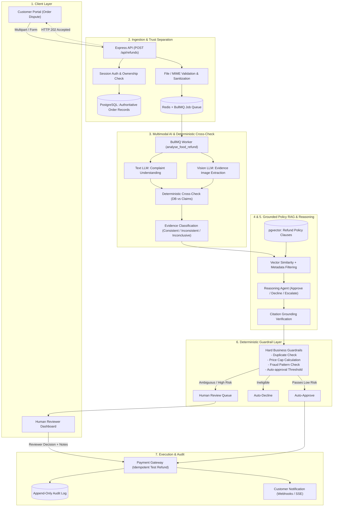

# RefundIQ - Food Delivery Refund Agent 🍔🔍

**RefundIQ** is an autonomous, multimodal AI dispute-resolution and refund processing system designed specifically for food delivery platforms (like Swiggy / Zomato).

It applies a strict **defense-in-depth architecture**: sandwiching AI multimodal perception and policy reasoning between **zero-trust frontend isolation**, **deterministic database cross-checks**, and **hard business guardrails**.

---

## 🏛 Architecture Overview

---

## 🚀 The 7-Step Pipeline

1. **Step 1: Customer Intake & Trust Separation**
   - Session authentication verifies identity (`customer_id`).
   - Order history fetched from authoritative PostgreSQL (`GET /api/orders`).
   - Read-only binding: Frontend displays items and totals, but submitted client values are **never** trusted by the backend.
   - Form collects: `order_id`, `issue_category`, `affected_items` (multi-select for item-level partial refunds), `description`, `requested_resolution`, and `evidence` photos.

2. **Step 2: Backend Ingestion, Verification & Queuing**
   - `POST /api/refunds` receives multipart data.
   - Input, MIME type, file size, and extension sanitization.
   - Database transaction creates `refund_requests` record with `status = 'SUBMITTED'`.
   - Pushes job `{ "request_id", "task_type": "analyse_food_refund", "order_id" }` to Redis + BullMQ.
   - Responds with **HTTP 202 Accepted** immediately.

3. **Step 3: AI Analysis & Deterministic Verification**
   - BullMQ worker consumes job and retrieves order context and uploaded media.
   - **Parallel AI Extraction**:
     - **Complaint Understanding (Text LLM)**: Extracts structured JSON (affected items, issue claims, resolution requested).
     - **Evidence Analysis (Vision LLM)**: Extracts visible packaging, food items, spillage, order labels, and image quality confidence.
   - **Deterministic Cross-Check**: Code matches claimed items against original bill, checks quantity caps, ownership, and delivery status.
   - **Evidence Classification**: Flags as `Consistent`, `Inconsistent`, or `Inconclusive`.

4. **Step 4: Policy Retrieval (RAG)**
   - Chunked refund clauses (`POL-01` to `POL-07`) embedded and stored in PostgreSQL with `pgvector`.
   - Dynamic search query crafted from category, items, description, and evidence status.
   - Top-k clauses retrieved with metadata filtering.

5. **Step 5: Reasoning Agent & Citation Validation**
   - Reasoning Agent evaluates facts against retrieved clauses and outputs recommendation: `APPROVE`, `DECLINE`, or `ESCALATE`.
   - Programmatic verification: Every cited clause ID must exist and must have been retrieved in the RAG step. Hallucinated citations trigger immediate human escalation.

6. **Step 6: Deterministic Guardrail Layer**
   - Backend code enforces hard financial rules:
     - Duplicate refund prevention.
     - Maximum refund amount bounded by affected item prices (never exceeding order total).
     - Customer suspicious history threshold.
     - Configurable auto-approval ceiling (e.g. ₹500).
   - Routes case to: `Auto-approve`, `Auto-decline`, or `Human review`.

7. **Step 7: Human Review, Refund Execution & Notification**
   - Reviewer Dashboard: Complete side-by-side inspection (original order, photos, AI summary, policy clauses, escalation cause).
   - Reviewer actions: Approve / Reject / Request Info (mandatory reviewer notes).
   - Payment Execution: Idempotent gateway refund API call, webhook verification, state update.
   - Append-Only Audit Trail: Tamper-evident ledger recording all decision events, policy versions, and timestamps.

---

## 🛠 Tech Stack

- **Runtime & Language**: Node.js 22 LTS, TypeScript 5
- **Backend Framework**: Express.js
- **Queue & Async Processing**: BullMQ, Redis 7
- **Database & Vector Store**: PostgreSQL 16 + `pgvector` extension
- **ORM / Migrations**: Drizzle ORM
- **AI Models**: Google Gemini 2.0 Flash (Multimodal Text & Vision), Gemini Embeddings (`text-embedding-004`)
- **Validation**: Zod (strict schema enforcement)
- **Frontend**: Next.js / React, Tailwind CSS, Lucide Icons
- **Infrastructure**: Docker & Docker Compose

---

## 📝 Project Milestones & Commit Tracker

The development directly mirrors the **7-Step Pipeline** specified in the design document, preceded by foundational infrastructure setup:

| Step | Pipeline Stage | Description | Status | Commit SHA |
| :---: | :--- | :--- | :---: | :--- |
| **0** | **Infrastructure & Foundation** | Docker setup (Postgres 16 + pgvector, Redis), config & packages | `DONE` | [`eb7f4c8`](https://github.com/DEEPAK-009/RefundIQ/commit/eb7f4c8) |
| **1** | **Customer Intake & Trust Separation** | Auth session mock, authoritative order lookup (`GET /api/orders`), read-only binding & refund form definitions | `DONE` | [`146cbb7`](https://github.com/DEEPAK-009/RefundIQ/commit/146cbb7) |
| **2** | **Backend Ingestion, Verification & Queuing** | `POST /api/refunds` (multipart upload, input/file validation, DB persistence, Redis+BullMQ async enqueue, HTTP 202) | `DONE` | [`5fbbe6e`](https://github.com/DEEPAK-009/RefundIQ/commit/5fbbe6e) |
| **3** | **AI Analysis & Deterministic Verification** | BullMQ worker, Text LLM complaint structuring, Vision LLM evidence inspection, deterministic DB cross-check, evidence classification | `DONE` | [`6d0719b`](https://github.com/DEEPAK-009/RefundIQ/commit/6d0719b) |
| **4** | **Policy Retrieval (RAG)** | Simulated refund policy chunks (POL-01..07) in pgvector, runtime semantic retrieval with metadata filtering, context assembly | `DONE` | [`9b4a4bb`](https://github.com/DEEPAK-009/RefundIQ/commit/9b4a4bb) |
| **5** | **Reasoning Agent & Citation Validation** | Policy evaluation agent (APPROVE / DECLINE / ESCALATE), programmatic citation validation (grounding check) | `DONE` | [`df9d937`](https://github.com/DEEPAK-009/RefundIQ/commit/df9d937) |
| **6** | **Deterministic Guardrail Layer** | Hard business rules (duplicate check, item price bounds, suspicious pattern check, auto-approval thresholds) | `DONE` | [`bbe68b9`](https://github.com/DEEPAK-009/RefundIQ/commit/bbe68b9) |
| **7** | **Human Review, Refund Execution & Notification** | Reviewer dashboard API & actions, payment gateway idempotency, webhooks, append-only audit logging & notification triggers | `DONE` | `step-7` |
